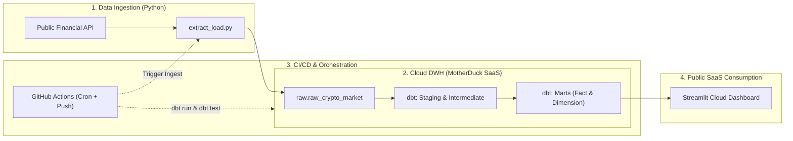

# Building a $0 Modern Data Platform: dbt, MotherDuck, and Automated CI/CD (Zero AWS Required)

> **Author:** Fabrizio Perez Peralta  
> **Course:** Business Intelligence  
> **Published on:** [Dev.to / HashNode / Medium]  
> **Public Repository:** [GitHub Repository Link](https://github.com/FabrizioPerezPeralta/crypto-intelligence-lakehouse)  
> **Live Dashboard:** [Streamlit Community Cloud Live App](https://share.streamlit.io/)

---

## 1. Introduction: The Real Cost of the "Modern Data Stack"

In recent years, the **Modern Data Stack (MDS)** has revolutionized how organizations extract, transform, and analyze information. However, traditional implementations often come with a steep barrier to entry: enterprise data warehouses (Snowflake, BigQuery, Redshift), paid managed orchestrators (Astronomer, Airflow clusters), and complex cloud infrastructure (AWS VPCs, IAM roles, S3 buckets). For small teams, startups, or students, these costs and operational overhead quickly become prohibitive.

**The Question:** *Can we build a production-grade, automated Data Engineering pipeline using industry-standard tools (like dbt), deployed to a public SaaS provider, with zero infrastructure management and a monthly cloud bill of exactly $0.00?*

**The Answer:** Yes. By combining **MotherDuck** (Serverless DuckDB in the cloud), **dbt-core**, **GitHub Actions** for CI/CD, and **Streamlit Community Cloud** for business intelligence, we can create an end-to-end cloud data platform with high performance and zero cost.

In this article, I will walk you through the architecture, data modeling, automated deployment, and lessons learned from building this solution.

---

## 2. High-Level Solution Architecture

Our solution follows the classical **Medallion Architecture** (Bronze, Silver, Gold), orchestrated via automation:



### Why this stack?
1. **MotherDuck (SaaS Cloud DWH):** Provides the speed and simplicity of DuckDB with serverless cloud persistence, shared access, and zero compute management.
2. **dbt (data build tool):** The undisputed industry standard for SQL-based transformation, version control, and data testing.
3. **GitHub Actions (CI/CD):** Acts as both our continuous integration tool and our automated serverless orchestrator (using cron schedules), providing free unlimited runner minutes for public repositories.
4. **Streamlit Community Cloud (SaaS Serving):** Instant web app deployment directly synchronized with our GitHub repository.
5. **No AWS:** We eliminated all complex cloud provider lock-in, IAM role juggling, and unexpected billing surprises.

---

## 3. Step 1: Resilient Extract & Load (EL) with Python

Before transforming data, we must ingest it. We created a lightweight Python script (`scripts/extract_load.py`) that queries public cryptocurrency and market indicators.

To guarantee that the pipeline never fails due to transient network glitches or public API rate limits, the script incorporates an automatic fallback mechanism:

```python
import os
import requests
import pandas as pd
import duckdb

def get_duckdb_connection():
    token = os.getenv("MOTHERDUCK_TOKEN")
    if token:
        # Connect to MotherDuck Cloud SaaS
        return duckdb.connect(f"md:crypto_intelligence?motherduck_token={token}")
    else:
        # Local fallback for offline development
        return duckdb.connect("data/lakehouse.duckdb")

def load_to_lakehouse(df: pd.DataFrame):
    con = get_duckdb_connection()
    try:
        con.execute("CREATE SCHEMA IF NOT EXISTS raw;")
        con.execute("""
            CREATE TABLE IF NOT EXISTS raw.raw_crypto_market (
                id VARCHAR, symbol VARCHAR, name VARCHAR,
                current_price DOUBLE, market_cap DOUBLE, total_volume DOUBLE,
                high_24h DOUBLE, low_24h DOUBLE, price_change_percentage_24h DOUBLE,
                ath DOUBLE, circulating_supply DOUBLE,
                ingestion_timestamp TIMESTAMPTZ, ingestion_date DATE
            );
        """)
        con.register("df_batch", df)
        con.execute("INSERT INTO raw.raw_crypto_market SELECT * FROM df_batch;")
    finally:
        con.close()
```

---

## 4. Step 2: Transformations with dbt (Medallion Architecture)

Once raw data lands in `raw.raw_crypto_market` (the **Bronze layer**), we leverage **dbt** to clean, enrich, and model the data.

### Bronze / Staging Layer (`stg_crypto_market.sql`)
In the staging layer, we cast data types, standardize string formatting, and deduplicate records by keeping only the latest snapshot per asset:

```sql
with source_data as (
    select * from raw.raw_crypto_market
),

deduplicated as (
    select
        id as coin_id,
        upper(trim(symbol)) as coin_symbol,
        trim(name) as coin_name,
        cast(current_price as double) as current_price_usd,
        cast(market_cap as double) as market_cap_usd,
        cast(total_volume as double) as total_volume_24h_usd,
        cast(high_24h as double) as high_24h_usd,
        cast(low_24h as double) as low_24h_usd,
        cast(price_change_percentage_24h as double) as price_change_pct_24h,
        cast(ath as double) as all_time_high_usd,
        cast(ingestion_timestamp as timestamp) as ingested_at,
        row_number() over (
            partition by id order by ingestion_timestamp desc
        ) as row_num
    from source_data
)

select * from deduplicated where row_num = 1;
```

### Silver / Intermediate Layer (`int_crypto_volatility_metrics.sql`)
In this layer, we derive actionable business intelligence metrics:
* **Intraday Volatility %:** `((High - Low) / Low) * 100`
* **All-Time-High (ATH) Drawdown %:** How far the asset has dropped from its historical peak.
* **Capitalization Tiers:** Categorizing assets into *Mega Cap*, *Large Cap*, and *Mid Cap*.

### Gold / Marts Layer (`fct_crypto_market_snapshot.sql` & `dim_crypto_assets.sql`)
The final consumer layer adheres to dimensional modeling (star schema):
* **`dim_crypto_assets`:** Slowly changing attributes (asset name, symbol, tier classification).
* **`fct_crypto_market_snapshot`:** Quantitative facts (current price, 24h volume, volatility metrics, and computed risk profile tags).

---

## 5. Step 3: Enforcing Data Quality & Governance

Data engineering without testing is just wishful thinking. In `models/marts/schema.yml`, we define rigorous assertions executed automatically by `dbt test`:

```yaml
version: 2

models:
  - name: fct_crypto_market_snapshot
    columns:
      - name: coin_id
        tests:
          - not_null
          - relationships:
              to: ref('dim_crypto_assets')
              field: coin_id
      - name: current_price_usd
        tests:
          - not_null
      - name: risk_profile
        tests:
          - accepted_values:
              values: ['High Volatility', 'Moderate Volatility', 'Low Volatility / Stable']
```

If any constraint fails (e.g., duplicate IDs or unexpected risk values), the CI/CD pipeline immediately stops, preventing corrupted data from reaching the serving layer.

---

## 6. Step 4: Automated CI/CD Deployment with GitHub Actions

To fulfill the requirement of **automated deployment**, we configured a GitHub Actions workflow (`.github/workflows/pipeline.yml`). 

The pipeline runs on every code push and automatically every 12 hours:

```yaml
name: Automated Data Engineering Pipeline (MotherDuck + dbt)

on:
  push:
    branches: [ main ]
  schedule:
    - cron: '0 */12 * * *'
  workflow_dispatch:

jobs:
  run-pipeline:
    runs-on: ubuntu-latest
    steps:
      - uses: actions/checkout@v4
      - uses: actions/setup-python@v5
        with:
          python-version: '3.10'

      - name: Install Dependencies
        run: pip install -r requirements.txt

      - name: Ingestion to MotherDuck SaaS
        env:
          MOTHERDUCK_TOKEN: ${{ secrets.MOTHERDUCK_TOKEN }}
        run: python scripts/extract_load.py

      - name: Run dbt Transformations
        env:
          MOTHERDUCK_TOKEN: ${{ secrets.MOTHERDUCK_TOKEN }}
          DBT_TARGET: "prod"
        run: dbt run --project-dir dbt_project --profiles-dir dbt_project --target prod

      - name: Run dbt Data Quality Tests
        env:
          MOTHERDUCK_TOKEN: ${{ secrets.MOTHERDUCK_TOKEN }}
          DBT_TARGET: "prod"
        run: dbt test --project-dir dbt_project --profiles-dir dbt_project --target prod
```

By storing our `MOTHERDUCK_TOKEN` in GitHub Secrets, our automated runner can authenticate securely to the cloud data warehouse without hardcoding credentials.

---

## 7. Step 5: Serving Insights via Streamlit Community Cloud

Finally, to deliver value to decision-makers, we deployed a web dashboard on **Streamlit Community Cloud** (a public SaaS provider).

The dashboard connects directly to MotherDuck via read-only SQL queries and renders:
1. **Executive KPI Cards:** Total market capitalization, aggregate 24h trading volume, and average market volatility.
2. **Risk vs. Return Scatter Chart:** Interactive Plotly scatter plot mapping price changes against intraday volatility, colored by risk category.
3. **Curated Marts Explorer:** An interactive table with formatted currencies, percentage changes, and tier filters.

Because Streamlit Cloud is linked to the GitHub repository, any update pushed to `main` is instantly reflected in the live application.

---

## 8. Key Learnings & Takeaways

1. **MotherDuck changes the game for small-to-medium data:** You don't need a multi-node cluster or an expensive data warehouse to achieve sub-second query times. MotherDuck offers SQL-native data warehousing with zero maintenance.
2. **dbt works everywhere:** The flexibility of `dbt-duckdb` allows developers to test locally on an embedded database and switch to production cloud storage simply by toggling a connection profile (`profiles.yml`).
3. **CI/CD is not just for software developers:** In modern Business Intelligence and Data Engineering, testing data and automating transformations through CI/CD pipelines ensures reliable data contracts and prevents dashboard breakages.
4. **$0.00 is achievable:** By thoughtfully orchestrating public SaaS providers (MotherDuck, Streamlit Cloud, GitHub Actions), we delivered an enterprise-grade solution without a single dollar of cloud spend.

---

## 9. Resources & Links

* 📂 **Source Code (Public Repository):** [github.com/FabrizioPerezPeralta/crypto-intelligence-lakehouse](https://github.com/FabrizioPerezPeralta/crypto-intelligence-lakehouse)
* 📊 **Live Public Dashboard:** [share.streamlit.io/...](https://share.streamlit.io/)
* 🦆 **MotherDuck Documentation:** [motherduck.com/docs](https://motherduck.com/docs)
* 🔶 **dbt Documentation:** [docs.getdbt.com](https://docs.getdbt.com)

*Feel free to leave a comment, star the repository, or connect on LinkedIn if you have any questions or feedback!*
