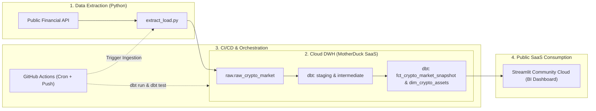

# 🚀 Zero-Dollar Modern Data Platform: MotherDuck, dbt, and GitHub Actions

[](https://github.com/)
[](https://www.getdbt.com/)
[](https://motherduck.com/)
[](https://streamlit.io/)
[](LICENSE)

An end-to-end, production-grade **Data Engineering & Business Intelligence** solution built entirely on **100% Free Public SaaS providers** (Zero AWS, Zero monthly cloud bills, and No credit card required).

---

## 📌 Architecture Overview



### Key Components & Stack:
* **Extraction & Ingestion:** Python script (`scripts/extract_load.py`) pulling cryptocurrency metrics.
* **Cloud Data Warehouse (SaaS):** **[MotherDuck](https://motherduck.com/)** (DuckDB in the cloud).
* **Transformations & Data Modeling:** **[dbt-duckdb](https://github.com/duckdb/dbt-duckdb)** applying a Medallion architecture (*Bronze* $\rightarrow$ *Silver* $\rightarrow$ *Gold*).
* **Data Quality & Testing:** `dbt test` verifying uniqueness, not-null constraints, and accepted values.
* **Orchestration & CI/CD:** **GitHub Actions** running automated workflows on push and via cron schedule.
* **Serving & BI:** **Streamlit Community Cloud** providing an interactive analytics dashboard.

---

## 📂 Project Structure

```text
├── .github/
│   └── workflows/
│       └── pipeline.yml         # CI/CD: Automated Ingestion, dbt run & dbt test
├── dbt_project/                 # dbt project directory
│   ├── models/
│   │   ├── staging/             # Bronze layer: deduplicated & cleaned views
│   │   ├── intermediate/        # Silver layer: enriched volatility & risk metrics
│   │   └── marts/               # Gold layer: fact & dimension tables for BI
│   ├── dbt_project.yml          # dbt project configurations
│   └── profiles.yml             # Connection profile for MotherDuck / local DuckDB
├── scripts/
│   └── extract_load.py          # Python EL pipeline
├── streamlit_app/
│   └── app.py                   # Streamlit Community Cloud dashboard
├── requirements.txt             # Project dependencies
├── ARTICLE_DRAFT.md             # Complete technical article for Medium / Dev.to
└── README.md                    # Project documentation
```

---

## 🛠️ Step-by-Step Setup Guide

### 1. Clone & Set Up Local Environment

```bash
# Clone the repository
git clone https://github.com/YOUR_USERNAME/crypto-intelligence-lakehouse.git
cd crypto-intelligence-lakehouse

# Create and activate virtual environment
python -m venv venv
# On Windows:
venv\Scripts\activate
# On Linux/macOS:
source venv/bin/activate

# Install dependencies
pip install -r requirements.txt
```

### 2. Configure MotherDuck (Cloud SaaS)
1. Go to **[motherduck.com](https://motherduck.com/)** and sign in with GitHub or Google (Free Forever tier, no credit card required).
2. Click on your profile settings and copy your **Service Token**.
3. Set the environment variable locally:
   * **Windows (PowerShell):** `$env:MOTHERDUCK_TOKEN="your_token_here"`
   * **Linux / macOS:** `export MOTHERDUCK_TOKEN="your_token_here"`

*(Note: If `MOTHERDUCK_TOKEN` is not set, the pipeline automatically falls back to a local `data/lakehouse.duckdb` file for offline testing).*

### 3. Run Pipeline Locally

```bash
# 1. Extract data and load into raw schema
python scripts/extract_load.py

# 2. Run dbt models (Silver & Gold layers)
cd dbt_project
dbt run --profiles-dir .

# 3. Execute data quality tests
dbt test --profiles-dir .
cd ..

# 4. Launch Streamlit UI
streamlit run streamlit_app/app.py
```

---

## 🤖 CI/CD Automation (GitHub Actions)

The workflow `.github/workflows/pipeline.yml` runs automatically:
1. **On every push** to `main`.
2. **On a schedule (every 12 hours)** via cron.
3. **Manually** via `workflow_dispatch` in GitHub.

### To enable automated cloud updates:
1. In your GitHub repository, go to **Settings > Secrets and variables > Actions**.
2. Click **New repository secret**.
3. Name: `MOTHERDUCK_TOKEN`, Value: *Your MotherDuck Service Token*.

---

## 🌐 Deploying the Dashboard on Streamlit Cloud (SaaS)

1. Go to **[share.streamlit.io](https://share.streamlit.io/)** and sign in with GitHub.
2. Click **New app** and select this repository.
3. Set Main file path: `streamlit_app/app.py`.
4. In **Advanced settings > Secrets**, add:
   ```toml
   MOTHERDUCK_TOKEN = "your_motherduck_token_here"
   ```
5. Click **Deploy!** Your interactive BI dashboard will be live on a public URL.

---

## 📝 Published Technical Article

Read the in-depth case study and implementation story:
* **Medium / Dev.to:** *[Link to your published article]*
* Raw draft available in [ARTICLE_DRAFT.md](ARTICLE_DRAFT.md).

---

## 👤 Author
* **Fabrizio Perez Peralta**
* *Business Intelligence - Unit II*
